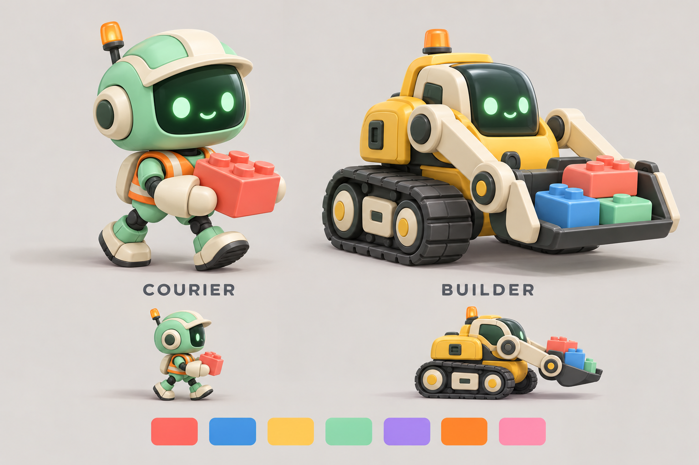
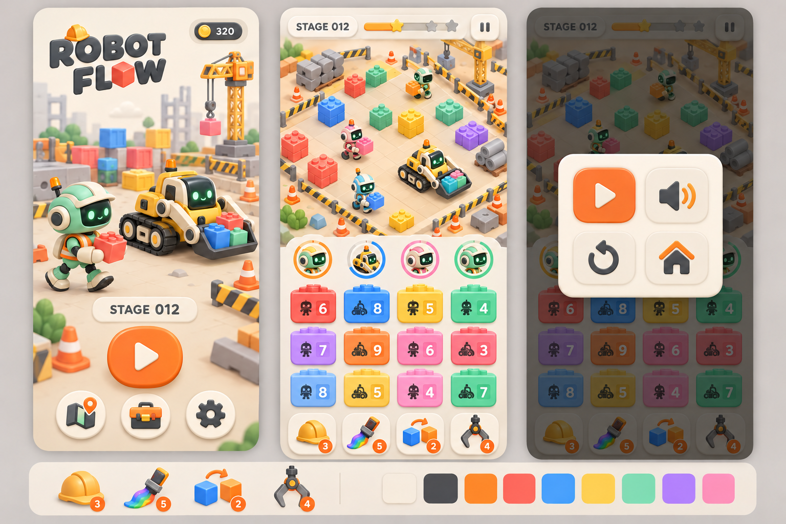
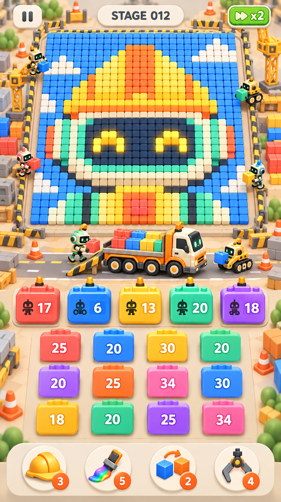

# 공사현장 테마 개편 계획

상태: v0.7.0 구현 완료. 최신 확정 규칙은 [게임 UI v0.7](game-ui-v07.md), 검증은 [v0.7 기록](v07-validation.md)을 기준으로 합니다. 아래 초기 계획 중 빈 공간 숨김·단일 트럭 교체는 이후 사용자 요청으로 변경되었습니다.

## 확정된 요청

- 컨테이너는 사용자 참고 이미지처럼 평면 행·열 격자에 나란히 배치. 위·아래는 화면의 행 위치이며 입체 탑이나 서로 겹친 카드가 아님.
- 각 컨테이너 열의 맨 위 컨테이너만 선택 가능.
- 선택한 컨테이너가 빠지면 아래 컨테이너가 위로 이동하며 새 맨 위 컨테이너가 선택 가능해짐.
- 대기 컨테이너를 선택하면 위쪽 5개 활성 컨테이너 자리 중 빈 자리로 올라감. 컨테이너에서 같은 색 로봇들이 출격. 빈 작업 공간 5개를 카드로 표시. 슬롯 추가 아이템 사용 시 최대 6개.
- 동시 활성 컨테이너 제한은 5개. 공용 트럭은 이 5개 컨테이너와 별개이며, 트럭마다 로봇 5기라는 규칙이나 트럭 5대라는 규칙은 없음. 사용자 설명으로 확인 완료.
- 로봇이 블록을 들어 올린 뒤 공용 트럭으로 이동해 싣고 탑승. 일정 적재량이 차면 트럭이 화면 밖으로 나가고 최대 3대 중 대기 트럭이 앞으로 이동. 남은 운반량에 따라 대기 대수를 줄임. 참고 이미지의 구멍으로 사라지는 동작을 이 모션으로 대체.
- 로봇은 두 단계만 사용. 크기 차이만 주는 대신 구조와 이동 방식이 다른 두 디자인 사용.
- 두 로봇 모두 컨테이너의 7가지 색에 따라 외장 색상 변경.
- 출발·이동·회전·집기·운반·복귀의 3D 모션 추가.
- 네 가지 아이템은 테마에 맞춘 그림 아이콘으로 표현.
- 로봇, 배경, 회수 자재를 귀여운 공사현장 스타일로 통일.
- 메인에서 전체 레벨 개수를 숨김. 스테이지 선택과 완료 메시지에서도 총 개수가 드러나지 않도록 검토.
- 일시정지 메뉴는 계속 플레이 / 사운드·진동 설정 / 다시 시작 / 메인 아이콘 중심으로 구성. 장식 문구 제거.

## 제안하는 디자인

- 총 7색: 코랄, 블루, 옐로, 민트, 퍼플, 오렌지, 핑크. 초반은 소수 색으로 시작하고 순차적으로 추가. 색별 문양도 유지해 구분 보조.
- 기본 운반원(COURIER): 안전모가 붙은 큰 머리, 분리된 작은 몸체, 두 팔과 두 다리, 부츠, 안전 조끼. 한 개의 자재를 양손으로 들고 걸어서 회수.
- 상위 중장비(BUILDER): 낮고 넓은 차체, 두 개의 궤도, 얼굴이 되는 운전석, 집게/버킷과 리프트 암. 사람형 다리 없이 굴러다니며 여러 자재를 싣고 회수.
- 두 종류는 얼굴 위치, 몸 구조, 바닥 접촉, 운반 장치와 이동 모션이 모두 다름. 큰 버전의 기본 로봇으로 대체하지 않음.
- 두 종류 모두 동일한 7색 팔레트를 사용. 외장 패널에 팀 색을 적용하고 크림 부품, 얼굴 유리, 궤도와 안전 오렌지 경광등은 공통 재질 유지. 총 14개 외형 조합을 두 모델과 재질 파라미터로 구성.
- 상위 단계 발동 규칙은 게이지 기반을 제안. 기존 10% 파워 출격과 메가 출격을 별도 세 단계로 유지하지 않음. 기존 기본 1개/메가 최대 8개 회수 수치는 우선 활용하되 레벨 난이도 검증 후 조정.
- 모래 바닥, 안전 펜스, 콘, 자재 더미, 작은 크레인으로 공사현장 구성. 장식은 이동 경로와 회수 대상의 가독성을 방해하지 않도록 외곽에 배치.
- 보드는 수백~천여 개의 작은 자재 블록으로 귀여운 그림을 표현. 규칙적인 줄무늬나 몇십 개의 큰 자재만 놓는 방식에서 변경. 자재 형태의 디테일은 그림을 알아보는 데 방해되지 않도록 단순화.
- 부스터 아이콘: 작업 공간 추가 = 헬멧과 +, 컬러 제거 = 페인트 도구와 색방울, 셔플 = 두 자재 상자와 교차 화살표, 꺼내기 = 크레인 집게. 보유 수량은 작은 배지, 효과 설명은 탭한 뒤 표시.
- 일시정지: 재생 삼각형 / 스피커·진동 / 원형 화살표 / 집. 접근성 이름을 제공하며 애매한 아이콘은 짧은 툴팁으로 설명.

## 앱 전체 아트 디렉션

- 기존 딥그린 텍스트 카드 중심 메뉴를 크림·차콜·안전 오렌지의 일관된 게임 디자인으로 개편. 팀 색 7종은 퍼즐 정보 전달에 집중.
- 메인: 로봇 두 종류가 있는 현장 디오라마, 작은 코인 배지, 현재 스테이지, 한 개의 강한 플레이 버튼, 지도/도구함/설정 아이콘. 긴 슬로건 제거.
- 게임: 작은 스테이지/일시정지 헤더, 회수 진행 바, 화면 폭을 채우는 큰 그림 보드, 아래 중앙의 공용 트럭 적재 지점과 출구 도로, 위쪽 5개 활성 컨테이너, 아래쪽 4열 대기 격자, 아이콘 부스터 푸터.
- 컨테이너: 평면 격자의 위쪽 선택 가능한 카드만 강조하고 아래 카드는 행 위치와 약한 색상 차이로 대기 상태 전달. 모든 카드 사이에 간격을 두며 서로 겹치지 않음. 작업 슬롯 격자나 READY/잠김 설명 없이 읽히도록 구성.
- 일시정지: 화면을 살짝 어둡게 하고 2×2 아이콘 패널만 표시. 재생은 오렌지, 사운드·재시작·메인은 차콜. 제목과 설명 문구 없음.
- 설정: 사운드·진동 아이콘과 토글/음량 조작 중심. 상점: 아이템 그림, 보유 배지, 가격과 구매 피드백 중심. 결과: 완료/재도전 시각 피드백과 필요한 다음 행동만 표시.
- 스테이지 선택: 열린 구간만 표시. '/200', 총 챕터 수, 최종 레벨을 알리는 문구 제거. 아직 방문하지 않은 구간은 탐험형 표현 사용.
- 터치 영역 최소 48dp, 시스템 안전 영역 대응, 아이콘 접근성 이름, 눌림/취소 피드백. 주요 게임 조작은 화면 안에서 고정.

## 아이템 무제한 이스터에그 — v0.4.1 구현 완료

- 설정 제목 영역을 5초 안에 7번 터치. 터치 사이가 1.2초보다 길면 다시 시작. UI에 스위치, 힌트, 남은 터치 수를 노출하지 않음.
- 같은 동작으로 On/Off 전환. '아이템 무제한 모드 On' 또는 '아이템 무제한 모드 Off'라는 짧은 게임 내 알림 표시.
- On이면 4종 아이템 보유 수량을 ∞로 표시하고 실제 수량을 차감하지 않음. 수량 0인 아이템도 사용 가능. 컬러 제거의 스테이지당 1회 제한도 On일 때 해제.
- Off이면 기존 보유 수량과 기본 아이템 규칙으로 즉시 복귀. 무제한으로 사용한 횟수가 나중에 차감되지 않음. 슬롯 최대치처럼 효과 자체의 유효성 조건은 유지.
- 상태는 저장되며 앱 재실행 후 유지. 전체 진행 초기화 시 기본 Off. 무제한 상태에서 불필요한 아이템 구매 버튼 비활성화.
- 실제 기기에서 On/Off 알림, 재실행 후 On 유지, 두 번의 셔플 사용에도 수량 유지, Off 후 원래 수량 복귀 확인. 테스트를 마친 기기의 모드는 Off로 유지.

## 3D 모션 설계

- 운반원: 컨테이너에서 등장 → 몸을 약간 기울여 출발 → 이동 거리와 연결한 교차 보행/팔 흔들기 → 회전하며 시선 이동 → 감속 → 몸을 낮추고 손으로 자재 잡기 → 양팔로 운반 → 공용 트럭에 짐 싣기와 탑승. 원래 컨테이너로 복귀하거나 구멍으로 순간 이동하지 않음.
- 중장비: 컨테이너에서 등장 → 경광등 반응 → 궤도 회전과 차체 가속 → 코너에서 차체와 리프트 방향 전환 → 리프트 내리기/자재 집기 → 적재량에 따른 작은 서스펜션 움직임 → 공용 트럭까지 운반 → 경사판을 통해 적재/탑승하는 형태 검토.
- 보행과 궤도 회전은 실제 이동 거리로 구동. 멈췄을 때 허공에서 걷거나 바닥을 미끄러지는 느낌을 줄임.
- 출발/정지 가감속은 예측 가능한 짧은 구간으로 제한. 방향 보간, 미세 몸체 흔들림과 자재 반동을 사용하되 경로와 색 가독성 유지.
- 1배속의 느린 이동 기조 유지. 2배속은 이동과 작업 모션을 함께 배속. 일시정지 시 이동·집기·운반을 함께 정지.
- 집기 완료 순간에 보드에서 자재를 제거하고 트럭에 내려놓는 순간 적재량 갱신. 타깃 예약을 모션 동안 유지하고 한 자재의 중복 회수/적재 방지. 승리는 보드 회수, 운반/탑승과 마지막 트럭 출발이 끝난 뒤 처리하도록 제안.

## 컨테이너와 작업 제한

- 사용자 첨부 이미지의 하단 대기 배열을 기준으로 4열 평면 격자를 우선 검토. 각 컨테이너는 독립된 둥근 정사각형이며 숫자는 회수 수량. 열 순서는 고정, 각 열 맨 위 컨테이너만 터치 가능.
- 선택 후 해당 열 아래 카드들이 화면 위 방향으로 정확히 한 행 이동하는 짧은 애니메이션. 다른 열은 움직이지 않음. 높이 방향 적층이나 카드 겹침 효과를 사용하지 않음.
- 자동으로 선택 가능한 카드를 앞으로 재정렬하거나 READY/잠김 라벨을 별도 표시하지 않음. 위치가 선택 가능 여부를 전달.
- 동시 활성 컨테이너는 기본 5개. 선택한 컨테이너 자체가 위쪽 줄로 올라오며 로봇의 출발점이 됨. 대표 로봇 배지나 트럭으로 컨테이너를 대체하지 않음.
- 각 컨테이너가 가진 출격/회수 작업이 끝나면 해당 컨테이너를 정리하고 자리를 재사용. 트럭의 출발 여부와 컨테이너 자리 해제를 연결하지 않음. 세부 완료 시점은 회수 중인 로봇이 있는 상태에서 조기 종료하지 않는 기준으로 구현.
- 컨테이너 숫자는 컨테이너가 담당할 남은 출격/회수 수량으로 일관되게 정의. 공용 트럭의 적재량과 다른 값임.
- 컨테이너 자리 5개가 가득 찼으면 새 컨테이너를 이동시키지 않고 대기 격자 순서도 유지. 작업 중인 로봇이 있는 동안 자리가 가득 찼다는 이유만으로 패배하지 않음.
- 슬롯 추가 부스터는 여섯 번째 임시 활성 컨테이너 자리라는 기존 추가 작업 공간 기능을 유지하도록 제안. 공용 트럭 대수나 적재량을 늘리는 효과와 혼동하지 않음.
- 뒤쪽 컨테이너 꺼내기는 선택한 카드를 해당 열 맨 위로 올리는 방식으로 정리. 셔플과의 차이를 명확히 유지.

## 별도의 공용 트럭

- 컨테이너 5개와 분리된 하나의 공용 적재 지점. 모든 색/두 종류 로봇이 각자의 자재를 이곳으로 운반. 트럭은 운반 로봇/중장비 로봇과 다른 배경 차량이며 세 번째 로봇 단계가 아님.
- 트럭 상태: 도착 → 적재 대기 → 로봇의 짐 싣기/탑승 → 적재 기준 도달 → 출발/바퀴 회전 → 화면 밖으로 퇴장 → 다음 트럭 도착.
- 초기 적재 기준은 예를 들어 20개 자재로 테스트하되 화면의 적재 표현과 출발 빈도를 보고 조정. 로봇 수 5 또는 활성 컨테이너 수 5와 연결하지 않음.
- 트럭이 교체되는 동안 짐을 든 로봇은 적재 지점에서 잠깐 대기하고 새 트럭에 실음. 운반 중 자재를 잃거나 순간 이동시키지 않음.
- 최종 회수가 끝나면 적재량이 기준보다 적어도 마지막 트럭을 출발시켜 미션을 마무리하는 연출 제안.
- 트럭 출발은 운반 완료를 보여주는 자연스러운 연출. 공용 트럭의 잠깐의 교체를 슬롯 교착이나 별도의 패배 조건으로 만들지 않음.

## 큰 그림 보드와 가독성

- 일반 스테이지는 32×32, 약 800~1,024개 블록을 우선 목표로 제안. 그림의 빈 공간에 따라 실제 개수는 다름. 짧은 튜토리얼은 16×16~20×20, 후반은 기기 성능과 읽기 쉬움을 확인해 최대 40×40을 검토.
- 안전모, 트럭, 귀여운 로봇 얼굴, 크레인 등 실루엣이 명확한 픽셀 그림을 준비. 팀 색 7종으로 이미지가 구분되도록 색 분포와 윤곽 검토.
- 보드는 화면 가로 폭 대부분을 사용하고 위쪽을 넓게 배정. 기존처럼 먼 카메라에서 빈 현장과 몇십 개 블록이 작게 보이지 않도록 보드 영역 중심으로 카메라 구성.
- 거의 정면에 가까운 높은 시점의 직교 카메라를 우선 검토. 블록 상단 색과 작은 두께가 보이되 원근 때문에 위쪽 블록이 더 작아지거나 서로 가리지 않도록 함.
- 장식은 보드 밖, 공용 트럭 적재 지점과 활성 컨테이너 줄은 보드 아래. 진한 색 구분과 절제된 그림자를 사용해 자재 밀도가 높아도 원래 그림을 알아볼 수 있게 함.
- 블록을 늘려도 회수 모션이 너무 오래 걸리지 않도록 승무원 반복 작업, 컨테이너 목표량과 경로 길이를 함께 조정. 1배속에서 눈으로 따라갈 수 있는 이동 속도는 유지.
- 렌더링은 자재마다 복잡한 둥근 메시를 개별 호출하는 방식 대신 단순한 자재 메시를 색/구역별로 묶어 그리는 구조로 변경. 제거 시 해당 구역만 갱신. 다수 로봇의 경로 계산과 타깃 예약도 분산.
- 첫 수백 개 블록 테스트 보드에서 전체 그림 인식, 5개 컨테이너 동시 작업과 공용 트럭 운반, 보드 감소에 따른 부하와 프레임 유지 확인 후 전체 레벨 생성으로 확대.

## 진행 순서와 확인 기준

1. 두 종류의 로봇 디자인과 앱 전체 시안 확인 후 실제 3D 모델 구조, 7색 재질, 상태별 모션 명세 확정.
2. 한 테스트 스테이지에서 평면 대기 격자/맨 위 선택/위 5개 활성 컨테이너 진입/로봇 출격/회수/공용 트럭 적재·탑승·출발 구현. 동일 열 상승과 5개 컨테이너 제한, 컨테이너 자리 재사용과 트럭 교체가 독립적인지 검증.
3. 구조가 다른 두 로봇 모델과 상태별 3D 모션, 회수 자재, 공사현장 배경 교체. 모바일 화면에서 대상 색·경로·로봇이 명확한지 확인.
4. 아이템 및 일시정지 아이콘, 총 스테이지 수 숨김 적용. 기존 저장과 아이템 구매/사용 흐름 유지.
5. 큰 그림 보드 렌더링과 다수 로봇 성능 검증 후 7색 레벨 구성과 난이도 검증. 모든 레벨 완주 시뮬레이션, 빌드/lint, 실제 기기 플레이 확인 후 APK 업데이트.

## 디자인 시안

앱 전체 v2 시안의 적층 표현은 제외. v3의 평면 대기 격자는 유지하되 작은 보드/대표 로봇 배지 부분은 큰 그림 보드, 위쪽 5개 활성 컨테이너와 별도 공용 트럭으로 대체. 아래 v5 게임 시안을 해당 화면의 새 기준으로 사용.

v5는 컨테이너→로봇 출격→블록 회수→공용 트럭 적재/탑승→트럭 퇴장의 배치를 표현한 정지 이미지. 트럭이 출발/교체하는 순간과 컨테이너 완료 순간은 서로 독립적이며 실제 모션은 구현 단계에서 제작.

시안의 운반원 민트/중장비 노랑은 형태 비교를 위한 예시. 실제 게임에서는 두 종류 모두 팀 색에 맞춰 변하고 같은 색 자재만 회수. 시안 내 여러 색 자재를 실은 모습이나 고정된 로봇 색은 게임 규칙으로 사용하지 않음.

내장 image_gen 도구로 만든 디자인 참고 이미지. 실제 게임의 실시간 3D 화면을 캡처한 이미지가 아님. 실제 모델은 NativeScene.java의 절차적 메시로 구현. 시안과 재질·세부 형태가 동일하지 않으며 기기 화면의 가독성과 성능에 맞춘 형태를 사용.

## v0.5.0 구현값

이 절의 기록은 v0.5.0 당시 기준이다. 500개 레벨, 최신 UI, 웹 미리보기와 ADB 설치는 [v0.6.0 검증 기록](v06-validation.md)을 따른다.

후속 수정(소스만 적용): 기본 1배속을 기존 2배속과 동일하게 변경. 게임 시뮬레이션과 3D 모션에 기본 배율 2를 함께 적용하며, 배속 버튼의 2×는 새 기본 속도의 두 배. 홈 미리보기 속도는 유지. 로컬 APK 빌드로 검증했으며 기기 재설치 및 커밋·푸시는 진행하지 않음.

최신 UI 후속 수정: [Colony Flow UI 비율 적용](colony-ui-reference.md)을 추가 기준으로 사용. 정사각형 컨테이너, 중앙 대기열, 보드 프레임, 돌출형 아이템 패널, 일반 48×48 보드로 소스를 변경했다. 아래 v0.5.0의 32×32와 기기 확인 기록은 기존 설치본 기준이다. 최신 소스는 로컬 빌드로 확인하며 기기 재설치와 커밋·푸시는 진행하지 않는다.

- 대기열은 화면에 3행을 표시하고 세로 스와이프로 뒤쪽을 살펴볼 수 있음. 앞쪽 선택 규칙은 스크롤과 관계없이 유지.
- 기본 이동 속도는 초당 5.2칸, 중장비 3.8칸. 출발 가속·회전 보간, 집기 0.22초, 적재 0.28초, 탑승 0.30초. 2배속은 전체 시뮬레이션에 적용.
- 트럭 적재 기준 20개, 출발·도착 각각 1.4초. 컨테이너 숫자는 아직 적재되지 않은 담당 자재 수. 마지막 담당 로봇 탑승 뒤 작업 공간 재사용.
- 10개 픽셀 그림 테마와 색상·외곽 배치 변형으로 200개 레벨 생성. 초반 400개/일반 1,024개이며 40×40 보드는 현재 사용하지 않음.
- 초기에도 그림에 필요한 색이 함께 등장. 점진적 색 해금은 현재 구현하지 않음.
- 자재는 8×8 구역별 메시로 렌더링하고 제거된 구역만 갱신. 아이콘은 네이티브 Canvas 도형.
- 메인/스테이지/완료 화면에 총 레벨 수 없음. 음악 알림 톤은 직접 합성한 짧은 소프트 차임으로 교체.
